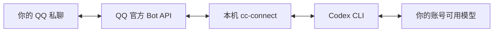

# QQ × Codex：搭建自己的 GPT娘

通过 **QQ 官方机器人 API → cc-connect → 本机 Codex CLI**，在 QQ 私聊里使用 AI 助手。

这是一份 Windows 实践教程及可复用示例。它记录从创建机器人、私聊配对，到设置人设、限制权限、切换模型的过程。不是腾讯或 OpenAI 的官方产品，也不是 cc-connect 的分支。

## 实际验证过什么

- Windows 本机运行 cc-connect **v1.5.0**，Codex CLI **0.166.0-alpha.5.1**。
- 用已登录的 ChatGPT 账号调用 Codex，QQ 私聊收发通过。
- 初次使用 GPT-6.1 Sol，之后切换至 **GPT-6 Luna / low**，简短回复测试通过。
- 自定义人设、仅允许配对用户、禁用管理指令、关闭部分工具、回复限频。

上述是这次实践的结果。公开版将本机路径、凭证和配对码参数化；已做静态验证，尚未在另一台全新电脑上完成端到端测试。模型、账号额度、QQ 权限及 CLI 参数可能随版本变化。

## 架构



QQ 只是消息入口。AI 和桥接运行在你的电脑上，**需要电脑开机、联网且程序持续运行**。锁屏通常可以；休眠、关机或断网后不能正常回复。代理关闭可能导致模型连接失败，离线期间消息不保证补收。

## 前置条件

1. Windows，建议 PowerShell 7；Node.js 22 或更新版本（示例使用内置 `fetch`、`WebSocket`）。
2. 安装 Codex CLI，并在终端执行 `codex login`。用 `codex login status` 验证。
3. 从 [cc-connect 上游发布页](https://github.com/chenhg5/cc-connect/releases/tag/v1.5.0) 下载 Windows 程序，将可执行文件命名为 `bin/cc-connect.exe`。
4. QQ 账号及 [QQ 开放平台](https://q.qq.com/) 上创建的机器人。

本仓库不分发第三方二进制，也不包含任何运行凭证。

## 第一步：创建 QQ 机器人

在 QQ 开放平台选择“在 QQ 与 OpenClaw 对话”一类的机器人入口，用手机 QQ 登录，创建机器人。记录 **AppID、AppSecret**，机器人应出现在你的 QQ 消息列表。

**不要混用入口：** `connect.qq.com` 的腾讯频道 Skills 用于频道相关能力，它的 Token 不能直接代替本教程的 QQ Bot AppSecret。

平台界面可能变化，以 [QQ 官方文档](https://bot.q.qq.com/wiki/develop/api-v2/) 为准。AppSecret 再次查看可能触发重置，保存后不要反复生成。

## 第二步：保存本机配置

在仓库目录打开 PowerShell：

```powershell
pwsh -NoProfile -File ./setup.ps1
```

按提示输入 AppID、AppSecret。密钥输入不回显，保存到被 Git 忽略的 `.local/credentials.json`。该文件是本机明文凭证，不是加密保险箱；不要分享或上传。

## 第三步：绑定自己的 QQ 身份

```powershell
node ./pair.mjs
```

看到 `READY` 后，在 QQ 私聊你的机器人，发送终端显示的六位配对码。脚本只接收这次配对消息，不调用模型、不回复群成员，也不执行电脑任务。匹配成功后写入 `.local/owner.json` 并退出。

**配对用 OpenID，不是 QQ 号码。** 示例默认只允许这一个身份。不要把 `allow_from` 改成 `*` 来解决不回复问题。

## 第四步：启动并测试

```powershell
pwsh -NoProfile -File ./start.ps1
```

在 QQ 给机器人发送“你好，请回复连接成功”。保持终端运行，`Ctrl+C` 停止。默认不设置开机自启。不要在已有实例运行时重复启动。

脚本自动生成 `.local/runtime.toml`，不会修改你的全局 Codex 配置。可先只生成配置：

```powershell
pwsh -NoProfile -File ./start.ps1 -ValidateOnly
```

## 人设与限制

复制出的 `persona.md` 是你的本机人设；仓库只提供一份中性的 `persona.example.md`，没有公开实践者的私人提示词。

在 `config.example.toml` 修改：

| 项目 | 默认值 | 说明 |
|---|---|---|
| `model` | `gpt-6-luna` | 先确认自己的账号可用；可改为其他支持模型 |
| `reasoning_effort` | `low` | 日常聊天优先低开销 |
| `mode` | `suggest` | 本版本 exec 后端是只读沙箱，不是交互审批 |
| `max_messages` | 6 / 分钟 | 限频，不是计费上限 |
| `max_turn_time_mins` | 1 | 单次任务时长上限 |
| `share_session_in_channel` | false | 不共享整个群的会话 |

默认禁用 QQ 内置命令、不授予管理员特权、关闭附件回传；关闭 shell、多代理、网页搜索及本机配置中识别出的 MCP/插件。这里只匹配常见顶层配置声明，**不保证覆盖所有项目配置、托管策略、未来版本或其他工具来源**。只读也不等于完全禁止读取所有文件，提示词不是隔离边界。

改完后重启桥接。人设在新 Codex 会话首次注入；旧会话不会自动重写。示例把生成的人设/模型设置哈希放进会话目录名，变更后使用新的桥接状态目录，旧数据不会被删除。

### 隐私与群聊

本例端到端验证的是**单人私聊**。上游支持群 @ 事件，但群聊场景权限、群内 OpenID 和使用范围需要另行确认。没有承诺支持“读取全部群消息”。不要直接公开给全群控制本机。

按用户/群分开会话键属于上下文隔离，不是不同操作系统账户之间的文件权限隔离。桥接和模型运行时仍可能保存会话缓存；`history.persistence=none` 不代表所有日志和模型会话都不落盘。没有自动清理和精确 Token/费用硬上限。

## 模型与额度

本次实践使用 ChatGPT 登录，未另外配置 API Key。实际可用模型、是否消耗包含额度或额外积分，以账号和工作区为准。ChatGPT Work 是产品模式，不是模型名；Work 和 Codex 共享用量规则，单纯切换入口不等于节省费用。请查看 [OpenAI 定价说明](https://learn.chatgpt.com/docs/pricing)，不要从本教程推算固定费用。

## 常见问题

| 现象 | 排查 |
|---|---|
| QQ 能登录，但 AI 不回 | 确认 bridge 在运行，Codex 已登录，模型可用，代理能联网 |
| 配对没收到 | 必须等终端出现 READY 后再发送；使用自己的机器人私聊 |
| 密钥失效 | 在平台确认是否重置过，在本机更新凭证后重启 |
| 代理开关后不恢复 | 重新开启代理；仍失败则停止并重新启动 bridge |
| 新人设没生效 | 重启，确认生成了新的状态目录；不要继续错误的旧会话 |
| `tools.view_image` 被忽略 | 本次 Luna 测试遇到过，公开版不把该参数作为安全控制 |
| `suggest` 没有逐次确认 | cc-connect v1.5.0 的 exec 后端为 read-only + never；不是 QQ 交互审批 |

`start.ps1 -ProxyUrl http://127.0.0.1:PORT` 只设置当前子进程的代理。默认不读取或修改系统代理；不传参数时继承已有环境。端口必须换成你自己的配置。

## 文件

- `setup.ps1`：本机凭证录入。
- `pair.mjs`：一次性 QQ 私聊配对。
- `start.ps1`：渲染配置并启动桥接。
- `config.example.toml`：可调整的桥接模板，含占位符，不能直接启动。
- `persona.example.md`：公开人设示例。
- `SECURITY.md`：发布及安全边界。

## 上游与许可

- [cc-connect](https://github.com/chenhg5/cc-connect) / [QQ Bot 接入指南](https://github.com/chenhg5/cc-connect/blob/v1.5.0/docs/qqbot.md)
- [腾讯 QQ Bot 文档](https://github.com/tencent-connect/bot-docs)
- [Codex 官方文档](https://learn.chatgpt.com/docs/codex-cli)

本仓库新增的文档和脚本采用 [MIT License](LICENSE)。上游产品、商标和依赖分别遵循其自身许可及服务条款。请勿在 Issue 中粘贴真实密钥、QQ 身份、私人对话或完整调试日志。
